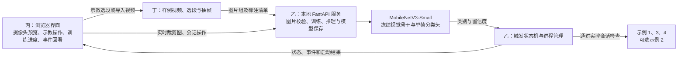

# Teachable Reality 手势与杯盖控制系统详细设计

本项目复现 CHI 2023 论文 *Teachable Reality* 的现场示教、端侧图像分类与触发动作。用户对着笔记本摄像头竖起大拇指，或打开、合上水杯盖，即可启动对应的 Windows 示例程序。按顺序做出「6 → 2 → 1」属于可选功能，时间不足时可放弃。基模采用论文引用的 **ImageNet 预训练 MobileNetV3-Small 1.0，输入 224 × 224**。课程版把论文里的 AR 场景反馈换成本地程序启动，保留“用户示范后即可现场使用”的交互方式。[论文第 4、5 节及 Google (2022c) 模型引用](https://arxiv.org/html/2302.11046)

## 1. 演示规则

| 用户动作 | 识别标签 | Windows 动作 | 何时触发 |
| --- | --- | --- | --- |
| **静态型**：手在取景框内竖起大拇指 | `THUMB_UP` | 启动 `示例1.exe` | 稳定确认后立即触发一次。持续保持只产生一次事件。确认回到空闲后可再次触发。 |
| **连续型（可选，时间不足可放弃）**：单手依次做出 6、2、1 | `GESTURE_6 → GESTURE_2 → GESTURE_1` | 启动 `示例2.exe` | 依次确认三个手势，且相邻两步在规定时间内完成。确认最后一步才触发一次。 |
| 把杯盖从完全合上变为完全打开 | `CUP_OPEN` | 启动 `示例3.exe` | 上一个已确认的杯盖状态是合上，当前确认打开。 |
| 把杯盖从完全打开变为完全合上 | `CUP_CLOSED` | 启动 `示例4.exe` | 上一个已确认的杯盖状态是打开，当前确认合上。 |
| 空桌、自然放下的手、杯盖完全遮挡 | `IDLE` | 保持空闲 | 无启动事件。 |
| 画面模糊或模型暂时无法确认 | `UNCERTAIN` | 等待下一帧 | 运行时状态。界面提示调整取景，动作决策继续等待。 |

水杯第一次稳定入镜时只记录初始状态。建议以**杯盖合上**开始演示，随后打开，再合上。每次确认开盖或合盖的状态变化才启动对应程序，保持同一状态只更新预览。各程序窗口由操作者自行关闭。采样与演示时，取景框内一次只摆一个待识别目标。做手势时移开水杯，拍摄水杯时保持手势自然，让杯盖与杯口之间的边缘清晰可见。

数字手势统一采用单手示范。6 为伸出拇指和小指，2 为伸出食指和中指，1 为只伸出食指。每一步短暂停留，让摄像头拍到清晰姿态。示例编号在两种交付范围下固定。基础版配备示例 1、3、4，示例 2 随连续手势功能交付。各程序用不同窗口标题标明对应动作。丁在演示机上逐一确认文件可以独立运行，乙配置安装位置。

## 2. 用户使用流程

1. **启动项目。** 双击本地启动脚本，打开 `http://localhost:8765`。点击「开启摄像头」并授权。页面显示实时画面、本地服务状态和当前已启用示例程序的准备状态。
2. **调整取景。** 在预览中框住手部或杯口。先让手完整入镜，再将水杯放到同一取景区，确认完全开盖、完全合盖的差异在画面上足够明显。
3. **录制示教。** 依次选择「竖大拇指」「杯盖打开」「杯盖合上」「空闲」，按提示录制或导入短视频。启用连续手势的项目还需分别录制数字 6、2、1 的稳定姿态。丙的页面调用丁实现的选段与抽帧功能，把选段导出为带标签的图片组，并显示每类样本数。用户可以删除拍糊的片段并补拍。
4. **训练和预览。** 点击「训练模型」，在预览页试做竖拇指和杯盖开合。启用连续手势时，额外试做「6 → 2 → 1」，页面显示步骤进度。界面显示预测、置信度和预计触发的程序名称，并生成模拟事件。
5. **开启程序触发。** 点击「开始控制」后，竖起大拇指启动示例 1。若启用了连续手势，先放下手回到空闲，再做「6 → 2 → 1」启动示例 2。接着展示合盖水杯入镜、打开杯盖启动示例 3、合上杯盖启动示例 4。界面记录动作、启动结果和事件时间。点击「停止控制」即可结束新的启动触发。
6. **纠正误触。** 从事件记录中选择「纠正这次触发」，查看当时的关键帧，补上正确标签。后端用修正样本训练候选分类头，用户可先预览再启用，也可回退。下次打开同一项目时，后台加载已启用版本，用户重新开启摄像头并开始控制。

状态主线为 **未连接 → 示教 → 训练 → 预览 → 实时控制**。用户可以随时退出实时控制回到预览。训练期间暂停动作判定，录像回放和纠错复测使用预览事件。丙负责在界面上把「仅预览」与「已开启程序触发」标识清楚。

## 3. 系统架构与技术选型



| 模块 | 技术栈 | 实现约定 |
| --- | --- | --- |
| 前端 | TypeScript、Vite、HTML/CSS、Canvas 2D | 丙负责通过 `getUserMedia` 读取摄像头、操作取景框和显示缩略图。示教选段与抽帧由页面调用丁的模块。 |
| 视频选段与抽帧 | TypeScript、浏览器视频解码与 Canvas 2D | 丁负责选定时间范围、按媒体时间抽帧、按取景框裁剪并生成图片组和清单。 |
| 本地服务 | Python 3.11、FastAPI、Uvicorn | 只监听本机回环地址。发布版由后端同时提供 Vite 构建产物和 API，页面与接口使用同一来源。 |
| 视觉模型 | TensorFlow、Google MobileNetV3-Small 1.0 `feature_vector/5`、四类或七类线性头 | 后端加载本地 SavedModel 并冻结骨干。基础版四类，启用连续手势时增加 6、2、1 三类。采样、现场识别和纠错使用同一预处理流程。 |
| 程序启动 | Python `subprocess.Popen` | 后端使用动作 ID 查询固定程序路径，维护事件号与进程句柄。 |
| 本地数据 | 项目目录、JSON、CSV、TensorFlow 权重文件 | 按项目保存示教样本、模型版本、测试标注和事件记录。发布包从本机读取预训练权重。 |

课程版选用 **Windows 本地 Python 服务**，让模型和程序启动模块由乙统一维护。演示机为 RTX 3070 笔记本，首版按原生 Windows TensorFlow CPU 路线部署，实际处理帧率以本机实测为准。先检查 CPU 能否达到第 6 节指标，锁定通过自检的依赖版本。原生 Windows 的 TensorFlow GPU 支持止于 2.10，装好 TensorFlow 后应记录实际使用的设备。[浏览器摄像头接口](https://developer.mozilla.org/en-US/docs/Web/API/MediaDevices/getUserMedia) · [FastAPI 静态文件](https://fastapi.tiangolo.com/tutorial/static-files/) · [TensorFlow 安装说明](https://www.tensorflow.org/install/pip) · [Python 进程启动接口](https://docs.python.org/3/library/subprocess.html)

## 4. 样本、模型与误触纠正

### 4.1 摄像头与样本

- 前端以 640 × 480 为采集目标，实际尺寸以视频轨道提供的值为准。记录归一化取景框，处理浏览器预览镜像和画面留白。推理源使用原始视频裁剪，覆盖层和提示文字绘制在独立画布上。
- 快速示教每类录 **2 段、每段 5 秒、约 6 帧/秒**。基础版四类共 8 段、约 240 帧。启用连续手势时，额外录 6、2、1 各 2 段，共补约 180 帧。正式示教可补到每类 4 段，并另录独立验证片段。丁先确定机位与杯盖清晰度，再录制第一批素材。
- 录竖拇指时变换手的距离和角度，空闲类覆盖自然手势、握拳、空桌和完全遮挡。水杯开与关尽量成对录制，相同杯子、相同机位下都采到两种状态。正在过渡而无法确定状态的帧略过，清楚可辨的部分遮挡仍按实际杯盖状态标注。连续手势使用单独录制的 6、2、1 稳定姿态作为分类样本，完整的连续动作视频用于验证顺序与计时。
- 以整段 `clipId` 分组，训练、验证、测试各用独立片段。同一段相邻帧只进入一个集合。验证片段用于调节门槛，锁定的测试片段用于最终验收。

### 4.2 丁与乙的图片组交接

丁交付的视频截取功能接收一段录制或导入的视频、选段起止时间、取景框和采样频率。功能从选段中抽帧，按取景框裁剪并导出 JPEG，保留帧在原视频中的媒体时间。丙提供页面上的录制、选段和导入操作，并调用这一功能。

乙的训练入口接收**一组已裁剪的图片和一份标注清单**。清单逐图记录文件名、`clipId`、`frameId`、媒体时间 `tMs`、类别和数据集归属。乙检查图像可解码、ID 唯一、标签有效以及片段划分一致，再缩放到模型输入尺寸并提取特征。丁保留原始视频，用于回放、复核和成果展示。

用于测试动作顺序的图片组保留时间戳、空闲帧和过渡帧，另附预期动作及其发生时间。乙按媒体时间顺序经预览会话送入识别接口，验证竖拇指去重、杯盖状态变化及可选的「6 → 2 → 1」。训练接口按清单读取训练组，使用标签明确的状态图片更新模型。

### 4.3 冻结骨干并训练分类头

Google 官方的 MobileNetV3-Small 特征模型接收 RGB 三通道图像。后端统一缩放到 224 × 224，按该发布版约定转换为 `float32` 并缩放至 `[0, 1]`。装载本地 SavedModel 时核对输入、输出签名和固定测试图的有限值，运行时用实际输出维度 `D` 创建分类头。按官方示例的 1024 维特征计算，四分类头有 **4,100 个可训练参数**，七分类头有 **7,175 个**。两种配置共用 MobileNetV3-Small，连续手势的时间顺序由第 5 节的状态机判断。前端预览、录像回放和摄像头实时流共用同一推理接口。[TensorFlow 官方模型清单](https://www.tensorflow.org/hub/tutorials/tf2_image_retraining) · [Small 特征提取示例](https://codelabs.developers.google.com/tensorflowjs-transfer-learning-teachable-machine) · [SavedModel 加载接口](https://www.tensorflow.org/api_docs/python/tf/saved_model/load)

基础分类顺序为 `THUMB_UP`、`CUP_OPEN`、`CUP_CLOSED`、`IDLE`。启用连续手势时，依次追加 `GESTURE_6`、`GESTURE_2`、`GESTURE_1`。采用 `Dense(K, softmax)` 和交叉熵，`K` 为项目启用的类别数。Adam 初始学习率 0.001、批量 16、最多 30 轮，保留验证损失最低的一轮。保存模型时同时记录类别顺序和连续手势配置。基础项目启用扩展时，补录三种姿态并训练新分类头。特征缓存以图像 ID、预处理版本和骨干权重摘要为键。新增样本时只给新帧提取特征。记录首次加载、训练和单帧推理实际耗时。

### 4.4 事件回标

作为课程微创新，后端保留触发帧前后短时间的裁剪图和预测。连续手势事件还保存 6、2、1 各步确认时的关键帧，便于定位哪一步识别有误。丙提供事件回顾界面。用户可以按当前项目的类别修正误判帧，或舍弃信息不足的帧。后端按帧 ID 去重，将修正样本加入训练集，以当前有效模型为起点训练候选分类头。

候选模型保存在新版本目录，完成验证和加载自检后才允许启用。回退通过切换有效版本完成。用户可以在预览模式下重放一次误触场景，核对更正、更新、启用与回退是否正常。事件缓存按会话释放，经确认的修正帧作为样本保存。

## 5. 实时决策、程序启动与模块接口

### 5.1 动作状态机

后端从单帧预测产生稳定状态，再按第 1 节映射生成动作。前端推理请求保持最多一帧在途，忙时跳过旧帧。以下是起步参数，依据验证录像调整后冻结。

| 检查项 | 起步规则 |
| --- | --- |
| 单帧确认 | 最高分类分数 ≥ 0.80，且领先第二名 ≥ 0.15。否则判为 `UNCERTAIN`，清除当前候选的连帧计数。 |
| 稳定状态 | 同类连续 3 帧才确认。相邻帧超过 250 毫秒时重新计数，避免跨断流合并。 |
| 竖拇指触发 | 从待触发状态进入稳定竖拇指时生成一个事件。稳定空闲后重新允许触发。低置信闪烁或短暂掉帧期间维持触发锁。 |
| 连续手势触发（可选） | 消费按时间排序的稳定姿态，依次确认 6、2、1 后启动示例 2。重复帧只算一次，顺序或时间不符时重置进度。 |
| 杯盖触发 | 首次稳定识别杯盖时建立基线。`CUP_CLOSED → CUP_OPEN` 启动示例 3，`CUP_OPEN → CUP_CLOSED` 启动示例 4。经过短时手遮挡可保留上次杯盖状态。超过 1.5 秒未再次确认杯盖或转入手势场景时清除旧基线。 |
| 会话与模式切换 | 开始、停止控制，切换摄像头、视频或模型版本时重置状态；旧会话的推理结果作废。停止控制请求与启动动作串行处理。 |

同一个动作事件只提交一次，分配唯一 `eventId`。即使启动失败，也需完成相应的手势复位或杯盖状态变化才能产生下一条新事件。运行时使用采集帧时间处理门槛，离线录像使用媒体时间。

**连续手势的可选实现。** 进入稳定的 6 后开始等待 2，确认 2 后等待 1。相邻两步的确认间隔初设为最多 2 秒。手指变换中短暂出现 `IDLE` 或 `UNCERTAIN` 可继续等待，计时照常。出现其他已确认姿态或超过时限时重置，重新进入稳定的 6 可以开启下一轮。完成后只发出一个示例 2 事件，待确认回到空闲再接受新一轮。界面显示「等待 6」「等待 2」「等待 1」或「已完成」。录制 **6 → 1、2 → 1、6 → 2 后超时**作为不触发用例。若排期不足，可按基础版交付。

### 5.2 调用本地 Windows 程序

后端从本机配置读取已启用动作对应的固定绝对路径。基础版检查示例 1、3、4，启用连续手势时同时检查示例 2。实际调用使用 `subprocess.Popen([absolute_path], shell=False, cwd=program_directory)`。浏览器只提交会话和摄像头图像，程序文件名、工作目录及运行参数由后端配置。一台机器上同一示例程序只保留一个由系统启动的活跃实例，后台用进程句柄检查是否已经退出。程序激活后让浏览器预览和示例窗口都可见，丁在正式演示前确认连续启动时画面可以继续取帧。

| 结果 | 页面反馈 |
| --- | --- |
| `STARTED` | 显示动作名、程序名和已受理时间。验收时另外由丁观察实际窗口是否可见。 |
| `ALREADY_RUNNING` | 显示该示例窗口已经打开，提示可先关闭窗口再重复动作。 |
| `PREVIEW` | 显示本次命中的动作和程序名称，用于训练后预览与测试录像回放。 |
| `FAILED` | 显示文件缺失、启动失败等原因，保留可回看的事件。 |

实控通过本地页面显式开启。后端核对本地页面来源、有效会话和当前模式，录像输入只允许预览模式。检测、训练和回放均使用会话 ID，切换来源或停止控制后丢弃迟到的结果。

### 5.3 前后端接口

| 接口 | 请求与响应要点 |
| --- | --- |
| `GET /api/health` | 返回模型、当前会话和已启用程序的可用状态，包括缺失的程序 ID。 |
| `GET /api/projects` 与 `POST /api/projects` | 列出或创建项目。项目信息包括名称、取景框、连续手势配置和有效模型版本。 |
| `POST /api/projects/{id}/clips` | 按第 4.2 节上传一个片段的 JPEG 图片组与标注清单。返回接收数量和无效记录。相同片段内的同一帧 ID 重传时返回已有记录。 |
| `POST /api/projects/{id}/train` | 启动训练任务并返回 `jobId`。前端轮询任务接口获取进度、候选版本和验证结果。 |
| `GET /api/jobs/{jobId}` | 返回训练阶段、轮次、错误和可启用的候选版本。 |
| `POST /api/projects/{id}/versions/{version}/activate` | 自检后切换有效分类头，用于首次启用、纠错发布和回退。 |
| `POST /api/sessions` | 建立摄像头或录像会话，选择预览或实控模式，返回 `sessionId`。 |
| `POST /api/sessions/{sessionId}/frames` | 发送 JPEG 裁剪图、`frameId`、帧时间。返回预测、稳定状态及可选的动作事件。启用连续手势时同时返回当前步骤。 |
| `POST /api/sessions/{sessionId}/stop` | 停止新的触发并关闭会话。 |
| `GET /api/events/{eventId}` | 返回事件详情及可选取的缓存缩略图。缓存到期时提示重新演示。 |
| `POST /api/events/{eventId}/corrections` | 提交被选中的帧 ID 和修正标签。结果作为候选训练的新增样本。 |

每条动作记录至少包含事件号、会话号、帧号、输入来源、时间、稳定类别、模型版本、动作 ID 和启动结果。捕获到反馈的端到端耗时由前端使用同一单调时钟计算。后端独立记录模型计算和启动请求耗时，便于定位瓶颈。

## 6. 测试与验收

丁准备示例录像、从录像导出的测试图片组、逐事件真值和实机演示。乙使用图片组和媒体时间复现推理与触发结果，丙处理页面状态显示和异常反馈。正式测试使用已锁定的 **Small 模型和运行参数**，记录功能通过情况与本机性能。

| 测试样例 | 预期结果 |
| --- | --- |
| 竖拇指并保持 3 秒，随后放下手，再竖拇指 | 录像回放出现两条预览事件。实机首次启动示例 1，第二次按窗口是否仍在运行返回相应结果。 |
| 合盖水杯入镜，随后开盖再合盖，并分别保持几秒 | 入镜只建立基线。开盖、合盖各生成一次事件，顺序为示例 3、示例 4。保持状态期间事件数不增加。 |
| 初始即为开盖状态，随后合盖 | 初始画面只建立基线。合盖调用示例 4。 |
| 手短暂挡住杯口、空桌、自然手势 | 均保持空闲或等待确认。长时间遮挡后，杯盖重新入镜时只建立初始状态。 |
| 摄像头拒绝授权、程序文件缺失、模型文件缺失 | 对应状态显示明确错误，用户修复后能够重新检查并进入预览。 |
| 测试录像、停止控制、切换项目 | 录像只记录预览。会话关闭后的迟到帧不会启动程序。 |
| 误触选帧回标、启用候选、回退 | 能查到事件与修正标签的关联，有效版本可切换，刷新页面后能恢复。 |
| 关闭外网后启动发布包 | 加载本地模型、开启摄像头、完成示教与程序启动。 |
| **可选**：依次做 6 → 2 → 1，最后保持 1 | 第三步确认时启动示例 2 一次。前两步显示进度，保持 1 期间事件数不增加。 |
| **可选**：跳步、顺序错误或超时 | 示例 2 无启动事件。重新进入稳定的 6 后可以再试。 |

丁为竖拇指、开盖和合盖分别录制至少一段标准视频，另录空闲、遮挡和换角度片段。交付连续手势时，再录正确顺序、跳步和超时等片段。标注文件记录 `clipId`、预期动作 ID、动作首次清晰可判的媒体时间和空闲区间。最终测试建议每种已交付动作至少 10 次，并记录至少 2 分钟空闲时段。录像中每个预期动作只匹配一条正确事件，重复事件单列为误触。真实启动测试由丁在演示机上逐项执行。

验收记录包括动作命中数与总次数、空闲误触次数与观察时长、首帧加载耗时、现场追加训练耗时、实际推理频率及命中动作的 P50、P95 延迟。初步目标沿用 **每秒至少 6 次有效推理，动作延迟 P95 不超过 850 毫秒**。连续手势的延迟从最后一步「1」首次清晰可判计到程序反馈，完成整组动作的时间可另记。测试表保留原始事件和失败现象，用于系统展示。

## 7. 四人分工与交接

| 成员 | 负责范围 | 交付物 |
| --- | --- | --- |
| **甲** | **技术方案汇报**。阅读原文、整理复现范围和技术路线、制作方案 PPT、排练并完成 10 分钟汇报。 | 技术方案 PPT、架构图、讲稿和答问提纲。 |
| **乙** | **系统后端**。负责模型加载、训练和推理、触发状态机、程序启动、事件回标与版本保存。 | 图片组校验与训练接口、模型权重准备说明、状态机、程序映射、日志及本地服务启动脚本。 |
| **丙** | **系统前端用户操作界面**。负责摄像头授权、取景与示教操作、训练和控制面板、预览、事件回看与纠错。 | 可操作的页面、与丁的选段抽帧模块及乙的后端接口联调后的构建产物。 |
| **丁** | **样例片段、视频截取与成果展示**。录制和标注样例，实现视频选段、抽帧和图片导出，并提供一个摄像头接口以供前后端调用。开展回放验收并记录实测结果，制作成果 PPT 并完成 8 分钟展示。 | 视频截取与抽帧模块、带标注清单的训练与测试图片组、原始录像、测试记录和成果展示 PPT。 |

丁录制样例并实现视频选段和抽帧，把首批图片组与标注清单交给乙，用于核对图像方向、标签和时间戳。随后丁锁定独立测试图片组，保留原始视频和事件真值。丙把丁的选段抽帧模块和乙的接口接入页面，串联训练、识别、启动与纠错。丁用最终构建版验收，甲根据接口说明、页面草图和样例准备技术方案汇报。

建议按三次交接推进：

1. **输入与启动各自跑通。** 丙交付摄像头预览和取景框，丁交付首批片段、图片组及清单，乙用图片组跑通本地 Small 并验证示例 1、3、4。甲形成技术方案图。
2. **接通示教、识别和触发。** 乙交付训练、推理和事件接口，丙串联用户流程，丁以预览回放核对动作顺序。
3. **锁定演示版本。** 丙、乙完成纠错和离线联调，丁录制实机证据并准备成果展示。甲按课程安排完成技术方案汇报。

基础版联调通过、排期仍有余量时，再安排连续手势。乙负责顺序状态机与示例 2 集成，丙负责采样入口和步骤提示，丁负责正例与错误顺序的测试片段。连续手势单独排期，时间不足时按基础版展示。

## 8. 项目交付与课堂演示

```text
frontend/                   TypeScript、Vite 和界面源码
backend/                    本地 API、模型、状态机、程序启动
camera/                     丁的摄像头程序，向前后端提供摄像头接口
models/mobilenetv3-small/   本地 SavedModel、来源及校验信息
demo-programs/              示例1.exe、示例3.exe、示例4.exe 及可选示例2.exe
fixtures/                   可分享的样例视频、图片组、标注及回放说明
results/                    验收记录、事件 CSV 与本机性能记录
scripts/                    首次安装、构建和本地启动脚本
README.md                   安装、权重准备、操作和复现步骤
```

开发机首次安装依赖、下载并校验模型。发布包中放入前端构建产物、后端及其运行环境准备说明、模型加载配置和程序位置检查。启动脚本从项目根目录启动本地服务，并打开控制页面。README 写清基础示例文件和可选示例 2 的放置位置，以及如何开摄像头、进入实控、回放测试和查看结果。丁在断网后演示一次完整流程并归档测试记录。

**技术方案汇报由甲完成，时长 10 分钟。** 讲清原论文的现场示教与 Small 基模、课程版的本地程序触发、误触回标和验收流程。PPT 首页注明 CHI 2023。

**成果展示由丁完成，时长 8 分钟。** 先竖拇指启动示例 1，再让合盖水杯入镜，然后开盖启动示例 3、合盖启动示例 4。若交付连续手势，可在杯盖演示之后做一遍「6 → 2 → 1」启动示例 2。最后用预览展示误触回看或模型版本回退，并给出已记录的功能与延迟指标。准备同机录制的视频作为现场演示素材。

课程交付包括两份中文 PPT、公开代码仓库、依赖说明与启动脚本。组内按本页动作表统一拍摄、联调和演示。
